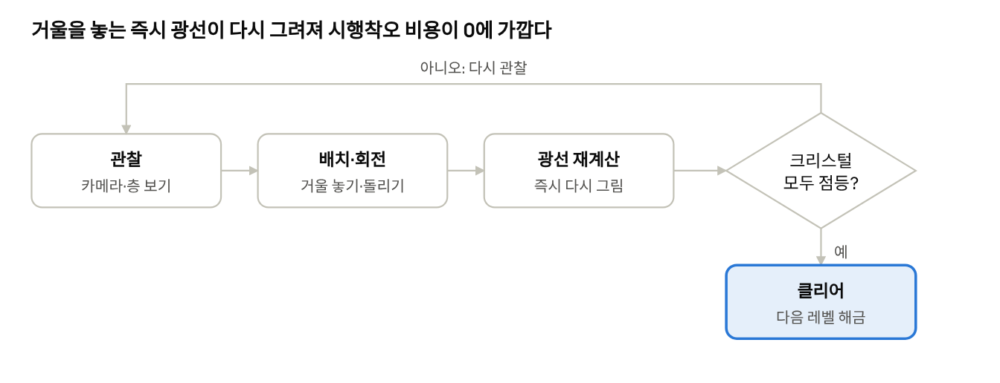
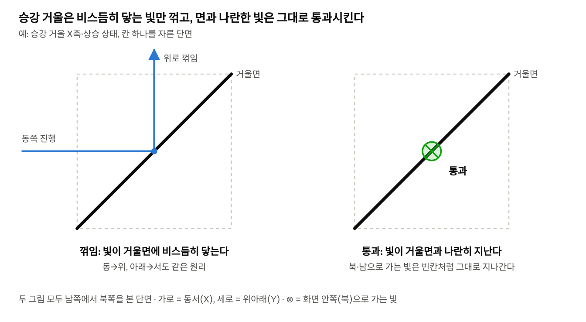
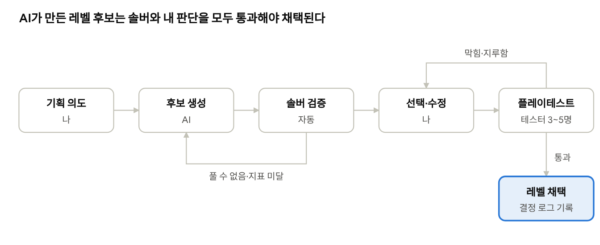
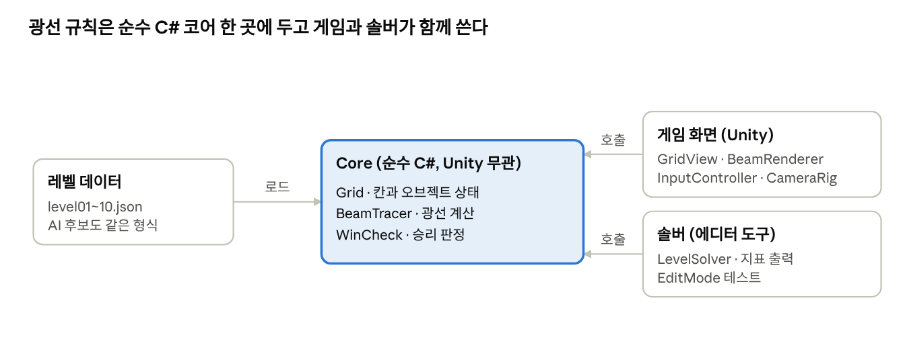
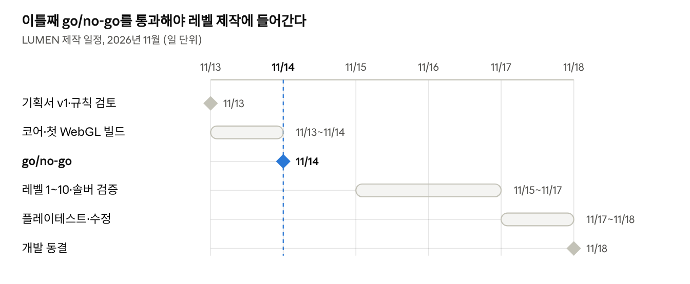

# LUMEN — 3D 빛 경로 퍼즐 기획서 v0

> **11/16 갱신(v2 레벨 설계 반영).** 바뀐 곳: 조작(카메라 이동·Home), 별 점수(거울 수 + 경로 길이), 해의 개수 규칙, 레벨 표(9레벨 이름), 플레이 모드(Fast/Normal).
> **11/16 밤 갱신(동결).** Fast Play 11판(마지막 판 「빛의 정원 II」 10×5×10 추가) / Normal Play 21판, 스테이지 선택 화면, 클리어 시 벽·받침대·바닥이 사라지는 연출, 층 보기 중 크리스털 항상 표시, 개발 동결 11/16. 아래 본문의 "10레벨/20레벨"은 Fast 11 / Normal 21로 읽는다.
> 결정 과정은 `decision_log.md`, 레벨별 의도는 `level_design_v2.md`. `lumen_design_doc_v0.docx`는 11/12 원본이라 이 내용이 없다.

Nov 12, 2026 · @fihsbowl · 넷마블네오 AI Game Maker 지원용

## 개요

LUMEN(가제)은 3D 격자 위에 거울을 놓아 광원의 빛을 크리스털까지 보내는
퍼즐 게임이다. 빛이 층을 오르내리는 것이 핵심이며, 한 판은 1~3분, 전체
10레벨을 10~15분 안에 끝낸다.

| 항목        | 내용                                                           |
|-------------|----------------------------------------------------------------|
| 한 줄 컨셉  | 위에서 보면 막혀 있는 길도, 빛을 위층으로 꺾으면 열린다        |
| 장르        | 3D 공간 퍼즐, 싱글 플레이                                      |
| 엔진·플랫폼 | Unity 3D, WebGL 빌드(브라우저에서 바로 플레이), PC 마우스 조작 |
| 분량        | Fast Play 11판 / Normal Play 21판 (11/16 밤), 처음 계획은 레벨 10개·10~15분 |
| 1차 타깃    | 지원서 평가자: 설치 없이 5분 안에 핵심 규칙과 3D 전환을 체험   |
| 2차 타깃    | 캐주얼 퍼즐 플레이어: 짧은 세션, 실패 비용이 낮은 시행착오     |
| 제작 기간   | 2026-11-13 ~ 11-18 (6일, 1인)                                  |

## 기획 의도와 차별점

차별점은 "3D가 장식이 아니라 풀이의 일부"라는 점이다. 대부분의 빛 반사
퍼즐은 2D 평면에서 끝난다. LUMEN은 수직 거울로 빛을 위·아래 층으로
보내야만 풀리는 레벨을 중심으로 다룬다.

- **관찰이 곧 풀이**: 카메라를 돌려 보아야 보이는 길이 있고, 그 순간이
  "아하" 포인트다.

- **즉시 피드백**: 거울을 놓거나 돌리면 광선이 바로 다시 그려져 실패
  비용이 0에 가깝다.

- **규칙은 적게, 조합은 많게**: 새 오브젝트는 3종(거울, 수직 거울,
  분할기)만 도입하고 난이도는 배치와 제약으로 만든다.

공고와의 연결: "아이디어를 실제로 플레이할 수 있는 게임으로" 만드는 전
과정을 6일 안에 보여 주고, 퍼즐의 풀이 가능 여부를 AI 솔버로 검증해
"AI를 도구로 기획과 개발의 경계를 넘는" 과정을 기록으로 남긴다.

## 핵심 루프와 조작

플레이어는 "관찰 → 배치 → 광선 확인"을 한 레벨에 10~30회 반복한다.
별도의 발사 버튼은 없고, 광선은 항상 켜져 있다.

핵심 루프 · 4단계, 판정 1회

발사 버튼을 두지 않는 이유: 항상 보이는 광선이 다음 수의 힌트가 되고,
플레이어가 요행수보다 관찰로 푸는 감각을 얻는다.

| 입력              | 동작                           |
|-------------------|--------------------------------|
| 좌클릭(빈 칸)     | 선택한 거울 배치               |
| 좌클릭(놓인 거울) | 90° 회전                       |
| 우클릭(놓인 거울) | 회수해 인벤토리로              |
| 우클릭 드래그     | 카메라 궤도 회전               |
| 휠                | 줌                             |
| WASD / 방향키     | 카메라 이동(강제하지 않는 편의 기능) |
| Tab               | 층 보기 전환(전체 / 1층 / 2층) |
| Z                 | 되돌리기                       |
| R                 | 레벨 리셋 + 카메라 처음 위치로(0.5초 동안 부드럽게) |
| Home              | 카메라만 처음 위치로(0.5초 동안 부드럽게) |

게임을 시작하면 메인 메뉴에서 **Fast Play**(11레벨, 게임을 가볍게 경험)와 **Normal Play**(21레벨, 사이사이 연습 레벨을 넣은 진짜 난이도 곡선)를 고른다. 고르면 스테이지 선택 화면으로 가고, 판마다 최고 별이 보인다. 'Easy'가 아니라 'Fast'인 이유: 실력이 아니라 시간을 기준으로 고르게 하려고. Normal 연습 레벨 10개는 레벨 에디터에서 직접 만들었다(11/16).

## 규칙 명세

광선은 격자를 한 칸씩 직진하고, 거울에서만 방향을 바꾼다. 모든
크리스털이 동시에 빛을 받으면 클리어다. 모든 규칙은 결정적이어서 같은
배치는 항상 같은 결과를 낸다.

### 격자

- 크기: 가로(X) × 세로(Z) × 층(Y). MVP 최대 7 × 7 × 3.

- 방향 6개: 동(+X), 서(−X), 북(+Z), 남(−Z), 위(+Y), 아래(−Y).

- 배치 가능 칸: 레벨이 받침대 타일로 지정한 칸에만 거울을 놓을 수 있다.
  플레이어에게는 힌트, 솔버에게는 탐색 범위 제한이 된다.

### 오브젝트

| 오브젝트  | 동작                                                      | 상태 수 | 도입 레벨 |
|-----------|-----------------------------------------------------------|---------|-----------|
| 광원      | 지정 방향으로 광선 1개 발사. 자신은 벽처럼 차단           | 고정    | 1         |
| 벽        | 광선 차단                                                 | 고정    | 1         |
| 크리스털  | 어느 방향에서든 빛을 받으면 점등, 광선 흡수               | 고정    | 1         |
| 평면 거울 | 수평 광선을 수평으로 90° 꺾음. 양면                       | 2 (/, ) | 1         |
| 승강 거울 | 수평 광선을 위·아래로, 위·아래 광선을 수평으로 꺾음. 양면 | 4       | 5         |
| 분할기    | 평면 거울처럼 꺾은 광선과 직진 광선, 2개를 내보냄         | 2 (/, ) | 7         |

모든 거울은 두 종류다. **배치형**은 인벤토리에서 꺼내 놓고 돌릴 수 있고,
**고정형**은 레벨에 박혀 있어 움직이거나 돌릴 수 없다.

### 반사 표

| 들어오는 방향 | 평면 거울 / | 평면 거울 \\ |
|---------------|-------------|--------------|
| 동(+X)        | 북(+Z)      | 남(−Z)       |
| 서(−X)        | 남(−Z)      | 북(+Z)       |
| 북(+Z)        | 동(+X)      | 서(−X)       |
| 남(−Z)        | 서(−X)      | 동(+X)       |
| 위·아래       | 차단        | 차단         |

승강 거울은 수평 축(X 또는 Z) 하나와 기울기 2가지를 골라 4상태다. 예를
들어 'X축·상승' 상태는 동→위, 아래→서, 서→아래, 위→동으로 바꾼다. 거울
면과 나란한 축(이 경우 북·남)의 광선은 빈칸처럼 그대로 통과한다.

승강 거울 단면 · 꺾임과 차단

광선은 항상 칸의 중심을 지나고, 승강 거울의 면도 칸 중심을 지난다.
그래서 북·남 광선은 거울면에 부딪히지 않고 면을 따라 지나간다. 이 경우를
'통과'로 정해 빈칸과 똑같이 처리한다. 거울을 Z축 상태로 돌리면 역할이
바뀌어 동·서 광선이 통과한다.

### 광선 계산

1.  각 광원에서 (칸, 방향) 상태로 광선을 시작한다.

2.  한 칸 전진한다. 격자 밖이면 소멸한다.

3.  도착한 칸의 오브젝트에 따라 처리한다: 빈 칸 통과, 벽·광원 정지,
    크리스털 점등 후 정지, 거울은 반사 표대로 방향 변경, 분할기는 광선
    2개로 나눔.

4.  이미 지나간 (칸, 방향)을 다시 만나면 그 가지는 멈춘다(무한 루프
    방지).

5.  안전장치로 전체 전진 횟수는 512로 제한한다.

### 승리 조건

모든 크리스털이 동시에 점등되면 클리어다. 인벤토리를 다 쓸 필요는 없다.
솔버의 해와 다른 배치로 풀어도 모든 크리스털이 켜지면 클리어다.

**별 점수 (11/16 변경, 조작 수 기준을 대체):** 거울 종류는 상관없다.
1. 빛을 꺾거나 나눈 거울 수가 최소 배치 수보다 많으면 **별 1개** (경로가 짧아도 "어시스트"를 더 받은 것으로 본다).
2. 아니면 경로 길이가 **Par 이하면 별 3개.** Par = 최소 배치 수로 푸는 해 가운데 가장 짧은 경로 길이(솔버가 계산).
3. 그 밖(같은 거울 수로 더 돌아간 경로)은 **별 2개.**

- 경로 길이 = 광원에서 나온 빛이 전진한 칸 수. 분할기가 있으면 남는 갈래까지 모든 갈래의 합(안 그러면 분할기만 마구 놓아도 된다).
- 빛이 닿지 않거나 꺾지 않은 거울은 세지 않는다. 시도하다 놓아 둔 거울로 감점되면 불쾌하다.
- 조작 수(놓기·돌리기·되돌리기·리셋)는 세지 않는다. 실패와 시도를 자유롭게 하기 위해서다.
- 클리어 연출: 빛이 광원부터 경로를 따라 순서대로 밝게 지나가고, 크리스털에 닿는 순간 반짝인다. 일정한 속도로 지나가므로 경로가 길면 연출도 길어져, 짧은 경로가 정답이라는 걸 몸으로 느낀다.
- 솔버보다 적은 거울로 풀린 기록은 솔버 오류 신호이므로 결정 로그에 남기고 솔버를 고친다.

## 엣지 케이스와 규칙 결정

아래 10건은 구현 전에 답을 정해 두어야 코드와 레벨이 어긋나지 않는다.
표의 '검토'는 11/13 AI 규칙 검토 때 확정한다.

| 상황                                      | 결정                                         | 이유                                                                  | 상태 |
|-------------------------------------------|----------------------------------------------|-----------------------------------------------------------------------|------|
| 두 광선이 같은 칸에서 교차                | 서로 영향 없이 통과                          | 간섭 규칙은 설명 비용이 크다                                          | 확정 |
| 광선이 다른 광원에 닿음                   | 차단                                         | 광원을 벽과 같게 취급해 규칙 수를 줄임                                | 확정 |
| 광선이 제자리를 도는 루프                 | 같은 (칸, 방향) 재방문 시 정지               | 무한 루프와 프레임 드롭 방지                                          | 확정 |
| 수평 거울에 위·아래 광선                  | 차단                                         | 평면 거울을 2D 규칙으로 단순하게 유지                                 | 확정 |
| 승강 거울 면과 나란한 광선                | 빈칸처럼 통과                                | 막는 규칙을 늘리지 않아 풀이의 자유도가 높다. 솔버도 같은 규칙을 쓴다 | 확정 |
| 크리스털에 광선 2개 동시 도달             | 점등 1회로 취급                              | 점등 여부만 판정                                                      | 확정 |
| 분할기에서 나온 광선이 다시 같은 분할기로 | 루프 규칙대로 정지                           | 광선 수 폭증 방지                                                     | 확정 |
| 광원 바로 앞 칸에 거울 배치               | 허용                                         | 받침대 타일로 레벨이 통제                                             | 확정 |
| 클리어 후 거울을 바꿔 점등이 꺼짐         | 클리어 순간 입력 잠금, 1초 연출 후 다음 레벨 | 판정 시점을 하나로 고정                                               | 확정 |
| 답이 여러 개인 레벨                       | 허용. 단 별 3개 해는 레벨마다 정확히 1개 (11/16, "8~10레벨 해 3개 이하" 삭제) | 경로 점수에서는 해가 여럿인 것이 실패의 자유. 가장 짧은 답만 하나로 정해지면 된다 | 확정 |

## 레벨 구성과 난이도 곡선

레벨 10개는 "새 요소 하나 소개 → 비틀기 → 조합" 순서로 세 번 반복한다.
3D 전환은 5레벨에서 처음 나오고, 9레벨이 이 게임의 대표 "아하" 퍼즐이다.
수치는 목표값이며 솔버 결과로 확정한다.

(11/16 v2) Fast Play 10레벨 = 소개 레벨 7개(1·2·3·4·5·7·9, 아하 하나씩, 직접 배치) + 조합 레벨 3개(6·8·10, 해 2개 이상: 짧은 해 별 3개, 돌아가는 해 별 2개). 레벨별 의도·실패·깨닫는 순간은 `level_design_v2.md`의 레벨 카드.

| \#  | 이름(가제)       | 새 요소              | 격자 X×Z×Y | 목표 최소 배치 수 | 플레이어가 얻는 것            |
|-----|------------------|----------------------|------------|-------------------|-------------------------------|
| 1   | 첫 빛            | 평면 거울            | 3×3×1      | 1                 | 반사 개념, 광선 즉시 갱신     |
| 2   | 두 번 꺾기       | 회전                 | 4×4×1      | 2                 | 회전으로 방향 고르기          |
| 3   | 막힌 길          | 벽                   | 5×5×1      | 2                 | 우회 경로 계획                |
| 4   | 유혹             | 고정 거울            | 5×5×1      | 3                 | 눈에 띄는 길이 오답일 수 있음 |
| 5   | 위층으로         | 승강 거울            | 3×3×2      | 1                 | 빛이 층을 올라간다            |
| 6   | 계단             | 승강 거울 2개        | 5×5×2      | 3                 | 올라갔다 내려오기             |
| 7   | 둘로 나누기      | 분할기, 크리스털 2개 | 4×4×1      | 2                 | 한 빛으로 두 목표             |
| 8   | 두 층 두 목표    | 분할기 + 승강        | 5×5×2      | 3                 | 갈라진 빛을 층별로 보내기     |
| 9   | 관점의 전환      | 관점 바꾸기(회전·층 보기) | 6×6×3 | 4                 | 처음 시점에서 가려진 크리스털을 관점을 바꿔 찾기 |
| 10  | 빛의 정원        | 종합                 | 7×7×3      | 5                 | 모든 규칙의 조합              |
| 11  | 빛의 정원 II     | 최종(11/16 밤 추가)  | 10×10×5    | 9                 | 판 전체를 쓰는 공간 퍼즐, 최단 경로 75칸 |

### 난이도 지표 (솔버가 계산)

- **최소 배치 수**: 클리어에 필요한 최소 거울 수. 레벨 순서대로 대체로
  늘어야 한다.

- **해의 개수**: 여러 개 허용. 단 별 3개 해(최소 배치 수 + 가장 짧은 경로)는
  정확히 1개(11/16 변경. 이전 규칙 "8~10레벨 3개 이하"는 삭제).

- **Par(경로)**: 최소 배치 수로 푸는 해 가운데 가장 짧은 경로 길이. 별 3개 기준.

- **탐색 공간**: 받침대 칸 수 × 상태 수의 조합 수. 너무 작으면 무작위
  클릭으로 풀린다.

- **층 전환 수**: 해에서 광선이 층을 바꾸는 횟수. 3D 체감의 직접 지표.

- **근접 오답 수**: 크리스털을 하나만 빼고 다 켜는 배치 수. "함정"의
  강도.

## AI 활용 계획

AI는 네 곳에만 쓰고, 무엇을 만들지와 무엇을 채택할지는 직접 결정한다.
모든 주요 결정은 결정 로그에 "AI 제안 / 내 판단 / 근거"로 남겨
포트폴리오의 증거로 쓴다.

레벨 제작 파이프라인 · 검증 루프 2개

레벨은 두 번 걸러진다. 솔버가 풀이 가능 여부와 난이도 지표를 기계적으로
거르고, 플레이테스트가 재미와 막힘을 거른다.

| 용도           | AI가 하는 일                        | 내가 하는 일                                    | 남길 증거                    |
|----------------|-------------------------------------|-------------------------------------------------|------------------------------|
| 규칙 검토      | 규칙 명세에서 모순·누락 케이스 찾기 | 채택 여부 결정, 엣지 케이스 표 갱신             | 표 변경 이력                 |
| 솔버 구현      | 완전 탐색 솔버 코드 작성            | 알고리즘 검토, 손으로 푼 레벨 3개로 정답 테스트 | 솔버 코드와 테스트           |
| 레벨 후보 생성 | 의도에 맞는 레벨 JSON 후보 여러 개  | 지표로 거르고 직접 골라 고침                    | 후보 수 → 채택 수, 수정 전후 |
| 구현 보조      | Unity 스크립트 작성                 | 씬 구성, 조작감 판단, 코드 리뷰                 | 커밋 이력                    |

직접 하는 일: 레벨 순서와 난이도 곡선, 최종 레벨 채택, 플레이테스트
해석. AI 상용 에셋은 쓰지 않고 기본 도형과 색으로 통일한다.

### 솔버 방식

1.  받침대 칸마다 "비움, 또는 인벤토리 거울 × 상태"를 고르는 백트래킹
    탐색.

2.  가지치기: 현재 광선이 지나지 않는 칸에 놓은 거울은 결과를 바꾸지
    않으므로, 광선 경로 위의 칸만 순서대로 탐색한다.

3.  출력: 해 목록, 최소 배치 수, 해의 개수, 층 전환 수, 근접 오답 수.

4.  게임과 솔버는 같은 광선 계산 코드를 공유해 규칙이 어긋나지 않게
    한다.

### 결정 로그 양식

| 날짜 | 결정 | AI 제안 | 내 판단과 근거 | 결과 |
|------|------|---------|----------------|------|
|      |      |         |                |      |

## 범위

MVP는 "레벨 10개를 브라우저에서 끝까지 플레이할 수 있다"가 기준이다. 이
기준에 필요 없는 것은 모두 미룬다.

**MVP (11/18까지 필수)**

- 규칙 명세의 오브젝트 6종과 광선 계산

- 레벨 10개, JSON 데이터로 분리

- 카메라 궁도 회전, 층 보기, 되돌리기, 리셋

- 클리어 연출 1종, 레벨 선택 화면

- 솔버와 레벨별 검증 결과

- WebGL 빌드와 공개 링크

**제외 (이번 버전에서 만들지 않음)**

- 색 광선과 색 필터, 어둠 크리스털(켜면 안 되는 목표)

- 스토리, 대사, 배경음악 제작

- 모바일 터치 조작, 저장 슬롯, 힌트 시스템

**스트레치 (일정이 남을 때만)**

- 효과음과 광선 파티클

- 최소 배치 수 별 표시

- 레벨 에디터(에디터 창에서 격자 배치 후 솔버 실행)

## Unity 기술 구조

광선 규칙은 Unity에 의존하지 않는 순수 C# 코어에 두고, 게임 화면과
솔버가 같은 코드를 호출한다. 그래서 게임에서 보이는 결과와 솔버의 판정이
어긋날 수 없다.

코드 구조 · 코어 1개, 사용처 2개

- **렌더링**: 기본 도형과 색, 광선은 LineRenderer. 외부 에셋 없이 먼저
  완성한다.

- **레벨 데이터**: JSON. AI가 후보를 바로 생성하고 솔버가 읽기 쉽다.

- **테스트**: 코어는 Unity Test Framework의 EditMode 테스트로 반사 표와
  엣지 케이스를 검증한다.

- **빌드**: Unity 6.3 LTS(안정판)의 WebGL, Web Build Support 모듈 설치,
  Decompression Fallback 켬. 플레이는 itch.io, 코드와 결정 로그는
  GitHub. 첫 빌드를 11/14에 미리 해 배포 문제를 일찍 드러낸다.

이 분리는 InEarth 회고에서 적은 개선점("테스트 가능한 순수 로직 분리")을
실제로 적용하는 사례이기도 하다.

## 플레이테스트 계획과 성공 기준

11/17~18에 게임을 처음 보는 테스터 3~5명이 설명 없이 플레이하고,
기획자는 말없이 관찰만 한다. 관찰 결과와 수정 내역은 그대로 포트폴리오에
들어간다.

| 측정 항목          | 방법                                                                       | 성공 기준                          |
|--------------------|----------------------------------------------------------------------------|------------------------------------|
| 레벨별 클리어 시간 | 화면 녹화 또는 스톱워치                                                    | 1~4레벨 각 1분 이내                |
| 포기·막힘 지점     | 30초 이상 무입력인 레벨 기록                                               | 전체 끝까지 간 사람 과반수         |
| 규칙 이해          | 설명 없이 1레벨 클리어 여부                                                | 테스터 전원                        |
| 3D 전환 체감       | 5·9레벨에서 카메라를 돌린 순간 반응                                        | "아하" 반응 또는 발언 1회 이상     |
| 주관 평가          | 플레이 후 질문 3개: 가장 좋았던 레벨, 가장 답답했던 순간, 다시 하고 싶은지 | 수정 우선순위를 정하는 근거로 사용 |

테스트 후 수정은 "관찰 → 원인 가설 → 수정 → 재확인"으로 결정 로그에
남긴다. 수적 기준은 표본이 3~5명이라 참고용이며, 포트폴리오에도 그렇게
표기한다.

## 일정과 go/no-go 기준

제작은 11/13에 시작해 11/18에 동결한다. 11/14 go/no-go에서 핵심 규칙이
돌아가지 않으면 신규 게임을 멈추고 대체안으로 간다.

제작 일정 · 11/13~11/18, 관문 1개

**11/14 go 조건 (3개 모두 충족)**

- [ ] 5×5×2 격자에서 평면·승강 거울을 놓고 돌리면 광선이 즉시 다시
  그려진다

- [ ] WebGL 빌드가 브라우저에서 열린다

- [ ] 1레벨을 처음부터 클리어할 수 있다

**no-go일 때**: 게임 제작을 멈추고, 이 기획서와 프로토타입 영상을 기획
산출물로, CanMoreImplant와 서버 데모 영상을 실행 증거로 제출한다. 11/19
이후는 포트폴리오와 지원서 작성에만 쓴다.

## 포트폴리오 연결과 미결정 사항

LUMEN은 포트폴리오의 대표 사례로, 공고의 세 역량을 한 프로젝트 안에서
보여 준다.

| 공고 역량   | LUMEN에서 보여 줄 증거                                                    |
|-------------|---------------------------------------------------------------------------|
| AI 리더십   | 결정 로그: AI 제안 중 채택·수정·기각한 것과 그 근거, 후보 수 대비 채택 수 |
| 구조화 능력 | 규칙 명세·엣지 케이스 표, 솔버로 수치화한 난이도 곡선                     |
| 학습 실행력 | 6일 안에 기획에서 WebGL 플레이 링크까지, 플레이테스트 후 수정 이력        |

포트폴리오 페이지 구성안: 플레이 링크와 1분 영상 → 기획 의도 → 규칙과
레벨 설계 → AI 파이프라인과 결정 로그 → 플레이테스트와 수정 → 한계.

### 미결정 사항

- [x] 게임 제목: LUMEN(가제) 유지

- [x] 승강 거울 면과 나란한 광선: 빈칸처럼 통과. 솔버와 다른 풀이도 모두
  정답 처리

- [x] ~~8~10레벨 해 3개 이하: 필수 규칙~~ → 11/16 삭제. 별 3개 해는 레벨마다 정확히 1개

- [x] Unity 6.3 LTS(안정판), 플레이는 itch.io, 코드는 GitHub

- [x] 테스터 3~5명: 모집 가능, 11/17·18 일정만 맞추기
